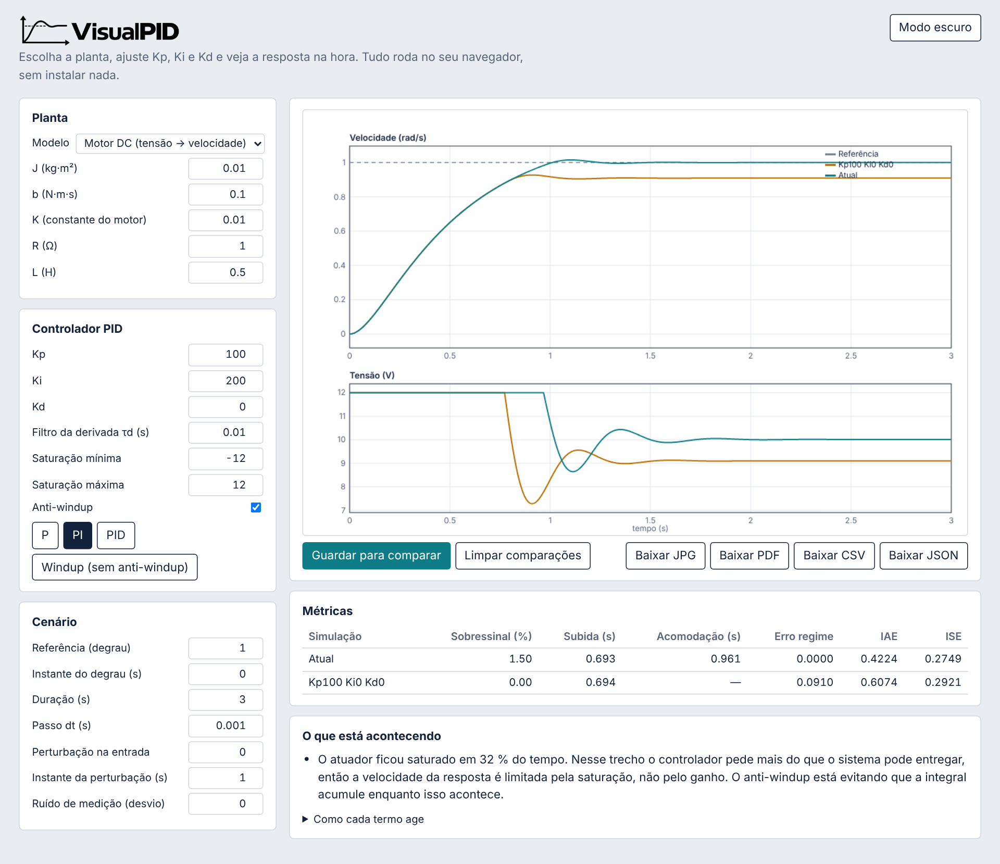
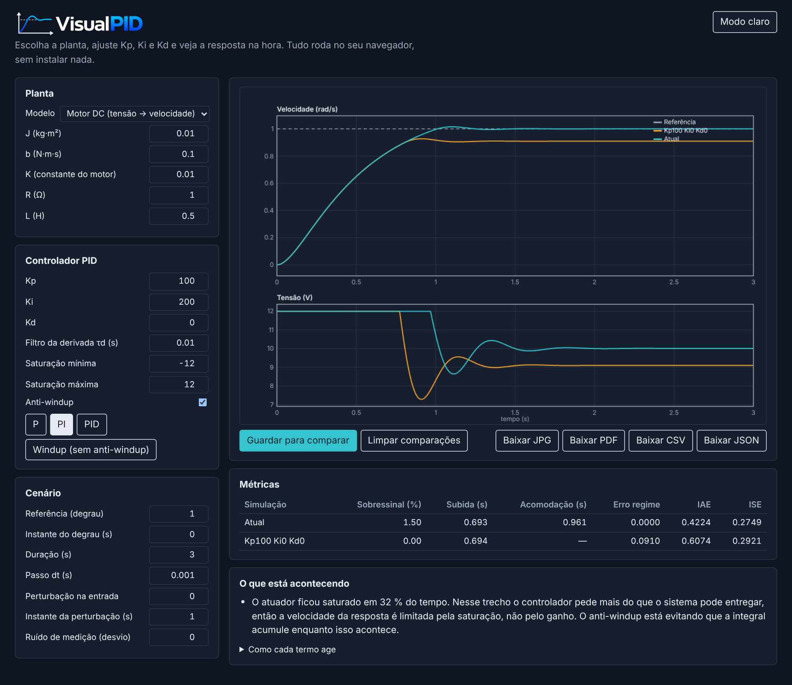
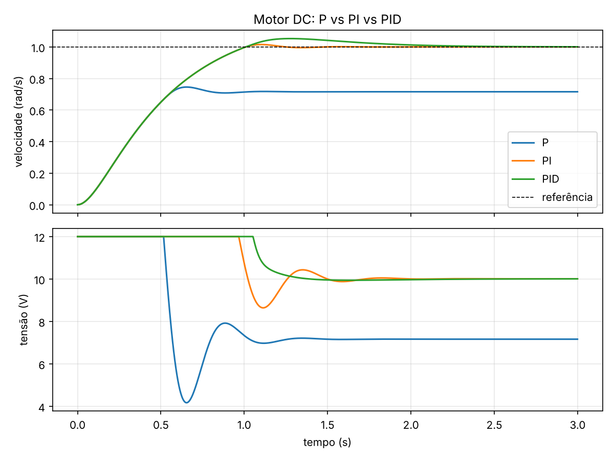
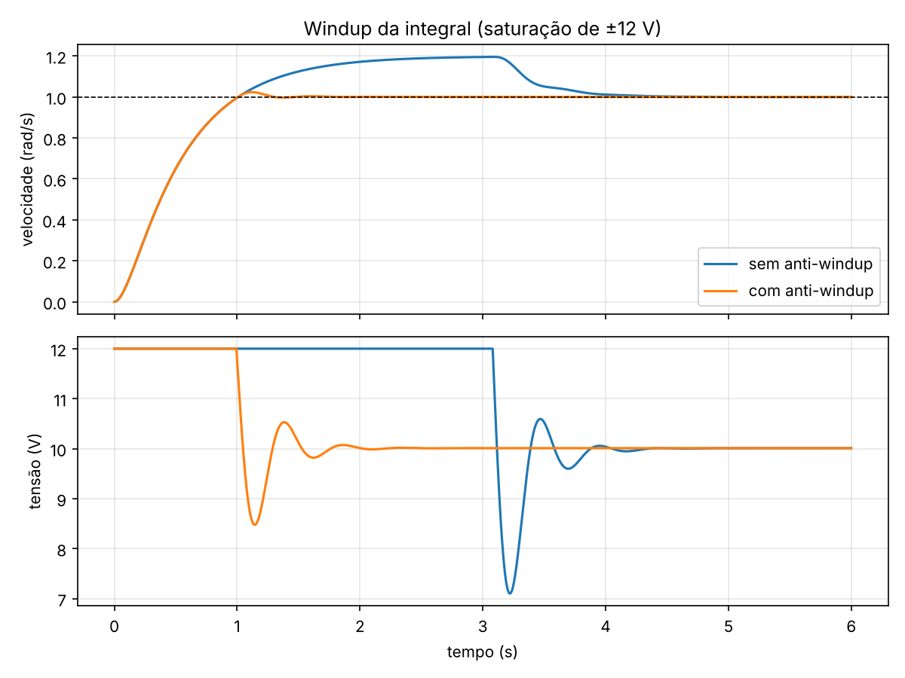

<h1 align="center">
  <picture>
    <source media="(prefers-color-scheme: dark)" srcset="assets/logo/visualpid-colorido.png">
    
  </picture>
</h1>

Simulador interativo de controlador PID que roda **direto no navegador**: sem instalação, sem compilador, sem internet.
Escolha uma planta, ajuste Kp, Ki e Kd, e veja na hora como o sistema responde e por quê.

**Demo online:** https://pedrones14.github.io/VisualPID/

[](https://github.com/pedrones14/VisualPID/actions/workflows/tests.yml)

<!-- Depois de tirar as capturas de tela, apague esta linha e a última e salve as imagens em docs/:


-->

## O que faz

- **Plantas:** motor DC (tensão → velocidade), sistema de 1ª ordem e massa-mola-amortecedor, com parâmetros editáveis
- **Controlador:** PID com filtro na derivada, saturação do atuador e anti-windup
- **Cenário:** degrau de referência, perturbação na entrada, ruído de medição e duração configuráveis
- **Métricas:** sobressinal, tempo de subida, tempo de acomodação (±2 %), erro em regime, IAE e ISE
- **Comparação:** guarda até 3 simulações para sobrepor no mesmo gráfico
- **Explicação automática:** um painel diz o que está acontecendo (saturação, falta de ação integral, ruído amplificado pela derivada etc.)
- **Modo claro e escuro**
- **Exportação:** JPG, PDF (relatório de uma página), CSV (abre direto no Excel) e JSON (parâmetros e métricas)

## Como usar

**Online:** abra o link da demo acima.

**Local:** baixe o repositório e dê dois cliques em `index.html`. Funciona offline.

## Como funciona

A cada passo `dt`, a página calcula o erro `e = r − y` e a saída do PID, `u = Kp·e + I + D`, limitada à saturação. Depois avança a planta com integração numérica Runge-Kutta de 4ª ordem.

- A derivada é aplicada na **medição** (sem pico quando a referência muda) e filtrada por um filtro de 1ª ordem de constante `τd`
- O anti-windup usa **back-calculation**: quando o atuador satura, a integral deixa de acumular
- As plantas são modelos em espaço de estados

## Validação

A pasta [`python/`](python/) contém um motor de referência com testes automatizados (pytest) que comparam o comportamento do simulador com a teoria. O GitHub Actions roda esses testes a cada commit, e os números do motor DC coincidem com os da página.

Motor DC, degrau de 1 rad/s, tensão limitada a ±12 V:

| Controlador | Sobressinal | Acomodação (2 %) | Erro em regime |
|---|---|---|---|
| P (Kp=100) | 0 % | não acomoda | 0,28 rad/s |
| PI (Kp=100, Ki=200) | 1,5 % | 0,96 s | 0 |
| PID (Kp=100, Ki=200, Kd=10) | 5,3 % | 1,82 s | ≈ 0 |



Sem anti-windup, o mesmo motor com Kp=100 e Ki=300 chega a **19,6 %** de sobressinal; com anti-windup, **2,3 %**.



## Estrutura

```
index.html      aplicação completa (HTML, CSS e JavaScript em um só arquivo)
python/         motor de referência em Python e testes
assets/logo/    logo do VisualPID (preta, colorida, branca e ícone)
docs/           capturas de tela e imagem de compartilhamento
.github/        testes automáticos (GitHub Actions)
```

## Roadmap

- [ ] Sugestão automática de ganhos (Ziegler-Nichols, Cohen-Coon)
- [ ] Resposta em frequência (Bode, margens de ganho e fase)
- [ ] Planta não linear (pêndulo invertido)
- [ ] Importar um CSV de dados reais para comparar com a simulação
- [ ] Comparação com LQR

## Autor

Pedro Henrique Nascimento de Oliveira — Engenharia de Controle e Automação, IFF Campus Campos Centro.

## Licença

MIT

## Identidade visual

| Versão | Arquivo | Quando usar |
|---|---|---|
| Preta | `assets/logo/visualpid-preto.png` | Fundos claros |
| Colorida | `assets/logo/visualpid-colorido.png` | Fundos escuros (as letras "Visual" são brancas) |
| Branca | `assets/logo/visualpid-branco.png` | Fundos escuros ou coloridos, em uma cor só |
| Ícone | `assets/logo/visualpid-icone.png` | Favicon, avatar e miniaturas |

Todas têm fundo transparente.
